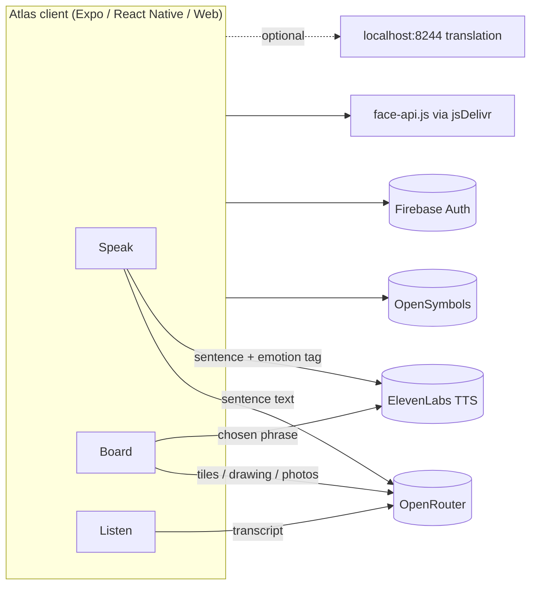

# Atlas

**A tile-based AAC (Augmentative and Alternative Communication) prototype with AI-assisted phrase building, drawing-to-speech, and expressive voice.**

Atlas helps non-speaking and minimally speaking users build sentences from symbol tiles, sketch or photograph what they mean, and have it spoken aloud with emotion. It also turns spoken conversation around the user into simple tiles they can respond with.

> ⚠️ **Prototype status.** Atlas is not a clinically validated AAC device. AI suggestions are assistive prompts, not guaranteed interpretations of a user's intent. Nothing is ever auto-spoken from an AI guess; the user always chooses.


---

## Table of contents

- [Features](#features)
- [How it works](#how-it-works)
- [Tech stack](#tech-stack)
- [Getting started](#getting-started)
- [Configuration](#configuration)
- [Platform support](#platform-support)
- [Project structure](#project-structure)
- [Data, persistence and privacy](#data-persistence-and-privacy)
- [Current limitations](#current-limitations)
- [Roadmap](#roadmap)

---

## Features

### 🗣️ Speak: sentence builder

- 64 core tiles plus **1,012 general words** in folders, lazy-loaded by letter bucket (`A–M`, `N–Z`), so startup stays fast.
- Tap a tile to hear it instantly (native `expo-speech`) and add it to the sentence bar.
- **Next-word suggestions** from an LLM, with a deterministic fallback (sibling tiles + `please`, `help`, `more`, `stop`, `yes`, `no`, `go`, `want`) when offline or on failure.
- Full-sentence **expressive speech** via ElevenLabs (`eleven_v3`) with an emotion audio tag.

### 🎨 Board: draw, place, interpret

- Pannable canvas with **draw, erase, select, and pan** modes.
- Place AAC tiles and photos (gallery or camera); move and resize them; undo and clear.
- Tap **Interpret** to get a few candidate phrases ("What you might mean"):
  - **Tiles only** → a cheap text model expands telegraphic input (`I → water` becomes "I want water"). No image is captured or uploaded.
  - **Drawings / photos** → a vision model returns phrases with confidence scores.
- Low confidence shows "I'm not sure" with **Try again**. Results are **never auto-spoken**; the user taps a phrase to speak it.

### 👂 Listen: speech to tiles

- Microphone input is transcribed in the browser, simplified into available tiles, and paired with suggested replies.
- Conversations are saved locally as text (up to 50).

### 🙂 Emotion-aware speech

- Optional camera-based emotion detection (`face-api.js`, ~3 FPS, smoothed) feeds the TTS emotion tag.
- Without the camera, emotion is classified from the sentence text (`neutral`, `happy`, `sad`, `excited`, `angry`, `calm`, `curious`, `thoughtful`).

### 🌐 More

- Google sign-in via Firebase with protected routes.
- OpenSymbols symbol lookup with local caching.
- English → Hindi tile translation (requires a local service; see [Limitations](#current-limitations)).

---

## How it works



**Speak**
`tiles → sentence → local/AI suggestions → ElevenLabs speech`

**Board**
`tiles only → cheap text model → phrase choices`
`drawing/photos → vision model → phrase choices`
→ user selects → ElevenLabs speaks

**Listen**
`microphone → Web Speech API → transcript → OpenRouter → AAC tiles + reply suggestions → saved text conversation`

### Board interpretation details

- Drawings are cropped to content bounds; web sends JPEG (512–1024 px), native sends PNG; at most **2 photos** are sent.
- Results are cached by a fingerprint of strokes, tiles, and images (in-memory, max 20). **Uncertain results are not cached**, so _Try again_ re-queries.
- Identical in-flight requests are de-duplicated, and stale responses are discarded if the board changed while waiting.
- If the tile-only model call fails, the exact tile sequence is shown with `uncertain: true`.

---

## Tech stack

| Area              | Implementation                                         |
| ----------------- | ------------------------------------------------------ |
| App framework     | Expo SDK 54, React Native 0.81, React 19               |
| Routing           | Expo Router (file-based)                               |
| Language          | TypeScript (`strict: true`)                            |
| Client state      | Zustand (in memory)                                    |
| Auth              | Firebase Authentication with Google                    |
| Local persistence | AsyncStorage                                           |
| Drawing           | `react-native-svg`                                     |
| Camera / photos   | `expo-image-picker`                                    |
| Speech output     | ElevenLabs (`eleven_v3`) and `expo-speech`             |
| Speech input      | Browser Web Speech API                                 |
| Emotion detection | `face-api.js` (browser or WebView)                     |
| Symbols           | OpenSymbols API                                        |
| AI                | OpenRouter chat and vision models                      |
| Translation       | Local HTTP service (`http://localhost:8244/translate`) |

There is **no application backend** in this repository. The client calls external APIs directly.

---

## Getting started

### Prerequisites

- Node.js and either [Bun](https://bun.sh) or npm
- API keys for OpenRouter, ElevenLabs, and OpenSymbols (see [Configuration](#configuration))
- A Google OAuth web client ID for native sign-in
- For native Google sign-in: a **development/native build** (it does not work in Expo Go)

### Install and run

```sh
cd atlas

# The checked-in package-lock.json is out of sync with package.json,
# so prefer the Bun lockfile:
bun install --frozen-lockfile
# or: npm install

cp .env.example .env.local
# fill in real values

npm run web       # web target (best-supported)
npm run start     # Expo / Metro
npm run android   # native Android build
npm run ios       # native iOS build
```

> There are currently no `test`, `lint`, or `typecheck` scripts in `package.json`.

---

## Configuration

Copy `atlas/.env.example` to `atlas/.env.local` and fill in:

| Variable                                 | Required                | Purpose                                                                     |
| ---------------------------------------- | ----------------------- | --------------------------------------------------------------------------- |
| `EXPO_PUBLIC_OPENROUTER_API_KEY`         | Yes, for AI             | Suggestions, transcript mapping, replies, emotion, board vision             |
| `EXPO_PUBLIC_OPENSYMBOLS_SECRET`         | Yes, for symbols        | OpenSymbols access token                                                    |
| `EXPO_PUBLIC_ELEVENLABS_API_KEY`         | Yes, for expressive TTS | ElevenLabs speech                                                           |
| `EXPO_PUBLIC_GOOGLE_WEB_CLIENT_ID`       | Native Google sign-in   | OAuth web client ID                                                         |
| `EXPO_PUBLIC_BOARD_INTERPRETATION_MODEL` | Optional                | Overrides the vision model (default `google/gemini-3.1-flash-lite`)         |
| `EXPO_PUBLIC_TILE_INTERPRETATION_MODEL`  | Optional                | Overrides the tile-only text model (default `google/gemini-2.5-flash-lite`) |
| `OPENROUTER_API_KEY`                     | Eval script only        | Used by `scripts/evaluate-board-drawing.mjs`; not bundled                   |

Firebase web config is **hardcoded** in `atlas/services/firebase.ts`; it is not read from environment variables.

The default chat model for suggestions is `dots-studio/dots-3-note-preview:free` (set in `services/openrouter.ts`).

---

## Platform support

| Feature               | Web (Chrome / Edge) |        Safari        | Firefox |       iOS / Android native        |
| --------------------- | :-----------------: | :------------------: | :-----: | :-------------------------------: |
| Speak (tiles, TTS)    |         ✅          |          ✅          |   ✅    |                ✅                 |
| Board                 |         ✅          |          ✅          |   ✅    |                ✅                 |
| Listen (speech input) |         ✅          | ⚠️ version-dependent |   ❌    | ❌ ("New Transcription" disabled) |
| Camera emotion        |         ✅          |          ✅          |   ✅    |          ✅ via WebView           |
| Google sign-in        |        Popup        |        Popup         |  Popup  |        Dev build required         |

Listen is effectively **web-only** today because it relies on `SpeechRecognition` / `webkitSpeechRecognition`.

---

## Project structure

```text
software_project/
├── AGENTS.md
├── README.md
└── atlas/
    ├── app/                   # Expo Router routes
    │   ├── _layout.tsx        # fonts, theme, auth gate
    │   ├── login.tsx
    │   ├── (tabs)/
    │   │   ├── index.tsx      # Speak
    │   │   ├── board.tsx      # Board
    │   │   ├── transcribe.tsx # Listen
    │   │   ├── settings.tsx
    │   │   └── emotions.tsx   # hidden debug route
    │   ├── debug.tsx
    │   └── modal.tsx
    ├── components/            # shared UI, board and emotion components
    ├── constants/             # colors, layout, tiles.json, tile builder
    ├── state/                 # Zustand stores and auth provider
    ├── services/              # OpenRouter, ElevenLabs, Firebase, OpenSymbols, ASR
    ├── utils/                 # suggestions, translation, drawing capture
    └── config/api.ts          # API keys, endpoints, board model
```

---

## Data, persistence and privacy

| Data                                                                  | Where it lives                                                                      |
| --------------------------------------------------------------------- | ----------------------------------------------------------------------------------- |
| Tiles, sentence, folder path, suggestions, settings, translated tiles | Memory only (reset on reload)                                                       |
| Board interpretation cache, ElevenLabs audio cache (last 20)          | Memory only                                                                         |
| Saved conversations                                                   | AsyncStorage `transcribe.conversations` (max 50, **text only; no audio is stored**) |
| OpenSymbols cache and token                                           | AsyncStorage `opensymbols_cache`, `opensymbols_token`                               |
| Auth session                                                          | Firebase SDK persistence                                                            |

**What leaves the device**

| Data                           | Sent to                                                                              |
| ------------------------------ | ------------------------------------------------------------------------------------ |
| Tile labels / sentence text    | OpenRouter, ElevenLabs                                                               |
| Drawing image + up to 2 photos | OpenRouter                                                                           |
| Speech audio                   | Browser's speech recognition service (Web Speech API)                                |
| Camera frames                  | Processed locally by `face-api.js` (the script and models are fetched from jsDelivr) |
| Symbol queries                 | OpenSymbols                                                                          |

### ⚠️ Security notes (read before deploying)

- `EXPO_PUBLIC_*` values are **embedded in the client bundle**. Anyone can extract them.
- OpenRouter, ElevenLabs, and OpenSymbols are called directly from the client.
- `config/api.ts` logs the first 20 characters of configured keys, and `services/opensymbols.ts` logs the token's length and prefix.
- **Before production:** put paid API calls behind a backend proxy and remove key logging.

---

## Current limitations

- Language is limited to English and Hindi, and Hindi needs a separate service running at `localhost:8244`. There is no deployed translation backend; if it is unreachable, original text is used.
- Tiles, sentence, folder position, and settings do not persist across reloads.
- Board has no pinch-zoom (`scale` is fixed at 1).
- The OpenDyslexic font is loaded, but there is no visible toggle in Settings yet.
- Saved conversations are labeled "recordings" in the UI, but no audio is stored or replayable.
- Suggestions without the LLM are deterministic, not learned.
- No test, lint, or typecheck pipeline.

<details>
<summary><b>Known dead or placeholder code</b></summary>

- `services/ai.ts`: placeholder, unused
- `components/DrawingCanvas.tsx`: unused
- `describeBoardContent()` in `components/InfiniteBoard.tsx`: exported but unused
- `mapTranscriptToTiles`: exists but is not integrated
- `components/__tests__/StyledText-test.js`: default snapshot test with no test script
- `@tanstack/react-query`: installed but unused

</details>

---

## Roadmap

Not implemented yet; listed as directions, not promises:

- **Production readiness:** backend/API proxy, persistent tiles and settings, real test/lint/typecheck pipeline
- **Personalization:** learned next-word prediction (e.g. collaborative filtering, Markov models) and feedback-driven improvement
- **Context awareness:** location / BLE / calendar-aware tile sets
- **Platform reach:** native speech recognition, offline / on-device AI and sketch recognition, board pinch-zoom
- **Sync and insights:** cloud sync, parent/teacher analytics dashboard
- **Accessibility polish:** visible OpenDyslexic toggle

---

## License

_Add a license here (e.g. MIT) before publishing._

